# Data Model (v4, star schema, staging-first)

This document defines how data moves through the warehouse (staging, silver, gold), which tables each layer holds,
at what grain, how the gold star schema connects, who produces every file, and what Power BI receives.
Version 4 replaces v3: loading is staging-first, gold is a star schema, there is no daily news table, and the machine
learning and benchmark files have an owner.

## 1. Decisions

| Question | Answer |
|---|---|
| How does data enter the warehouse? | Every CSV is loaded into `staging` first, exactly as it is. SQL scripts build `silver` from staging and `gold` from silver. Nothing is loaded straight into silver or gold. |
| What do the notebooks do? | They only produce CSV files. Calculations that need Python (risk, correlation, portfolios, event study, machine learning) are notebooks; their CSV outputs enter at staging like every other file. |
| What does each layer mean? | `staging` = the file as received (all text, no keys). `silver` = typed, keyed and de-duplicated. `gold` = star schema for analysis and Power BI. |
| Which tickers are kept? | The ten project tickers: `AAPL`, `JPM`, `MSFT`, `NVDA`, `JNJ`, `XOM`, `KO`, `AMZN`, `LLY`, `TSLA`. `SPY` is the benchmark and lives in `benchmark_prices`, not in `dim_company`. |
| Is `news_tickers.csv` worth keeping? | Yes. It is a small two-key table that splits each article into one row per project ticker, so SQL never has to read the `symbols` JSON. In v4 it also carries `n_symbols_total`, `n_project_tickers`, `published_at` and `reaction_date`. `news_clean.csv` is not loaded: it repeats article text and sentiment that `news_articles_sentiment.csv` already holds. |
| Why is there no daily news table? | Articles are not daily per ticker (KO about 1 per day on average, TSLA about 21, with uneven spread). News is stored per article-ticker (`fact_news`), summarised per ticker-month (`fact_news_monthly`), and turned into trailing 5- and 20-day windows only inside the machine learning features. |
| How do news and prices meet? | Through `reaction_date`: the first trading day the market could react (New York time; at or after 16:00, weekends and holidays roll to the next trading day). `fact_news` carries the stock's return on that day and the day after. |
| Which volatility is used? | `vol_20d_ann` (annualized standard deviation of the last 20 daily returns) for time series, and `annualized_volatility` in `risk_metrics` for the whole 2021-2025 period. The 30-day and 63-day versions stay inside notebooks. |
| Which events count? | Earnings announcements and 8-K filings. An 8-K with item `2.02` duplicates its earnings event and is excluded from event measures. |
| Who owns what? | P1 market and event reaction; P2 collection (SPY), news, companies, events, fundamentals, machine learning; P3 risk, correlation, portfolios; P4 warehouse and Power BI. |
| Data cutoff | Prices end on 2025-12-30. Articles run to 2025-12-31. This is documented, not corrected. |

## 2. Loading architecture

```
Notebooks (Python)              Warehouse (SQL Server, database MarketPulseDW)                 Power BI
------------------              ----------------------------------------------                 --------
CSV files in data/processed --> staging.<file>  --01_staging.sql / loader-->  (all text, as is)
                                      |
                                      v   02_silver.sql  (cast types, keys, remove duplicates)
                                 silver.<table>
                                      |
                                      v   03_gold.sql    (dimensions, facts, views)
                                 gold.<dim_*>, gold.<fact_*>  ---------------------------> import
```

Files and staging tables (one loader entry per row; table name = file name):

| # | File | Staging table | Producer | Status |
|---|---|---|---|---|
| 1 | `companies.csv` | `staging.companies` | P2 | exists |
| 2 | `market_clean.csv` | `staging.market_clean` | P1 | exists |
| 3 | `market_features.csv` | `staging.market_features` | P1 | exists |
| 4 | `benchmark_prices.csv` | `staging.benchmark_prices` | P2 | new, week 6 |
| 5 | `risk_daily.csv` | `staging.risk_daily` | P3 | new, week 6 |
| 6 | `risk_metrics.csv` | `staging.risk_metrics` | P3 | exists, adds `beta` in week 7 |
| 7 | `risk_monthly.csv` | `staging.risk_monthly` | P3 | rebuilt, week 6 |
| 8 | `correlation_pairs.csv` | `staging.correlation_pairs` | P3 | new, week 7 |
| 9 | `portfolio_weights.csv` | `staging.portfolio_weights` | P3 | new, week 7 |
| 10 | `portfolio_daily.csv` | `staging.portfolio_daily` | P3 | new, week 7 |
| 11 | `portfolio_metrics.csv` | `staging.portfolio_metrics` | P3 | new, week 7 |
| 12 | `events_clean.csv` | `staging.events_clean` | P2 | exists |
| 13 | `event_study.csv` | `staging.event_study` | P1 | new, weeks 6-7 |
| 14 | `fundamentals_clean.csv` | `staging.fundamentals_clean` | P2 | exists |
| 15 | `news_articles_sentiment.csv` | `staging.news_articles_sentiment` | P2 | exists |
| 16 | `news_tickers.csv` | `staging.news_tickers` | P2 | v2 in week 6 (reload) |
| 17 | `ml_features.csv` | `staging.ml_features` | P2 | new, week 7 |
| 18 | `ml_predictions.csv` | `staging.ml_predictions` | P2 | new, week 8 |
| 19 | `ml_metrics.csv` | `staging.ml_metrics` | P2 | new, week 8 |
| 20 | `ml_feature_importance.csv` | `staging.ml_feature_importance` | P2 | new, week 8 |
| 21 | `correlation_matrix.csv` | `staging.correlation_matrix` | P3 | exists, kept only as an audit copy |

Not loaded (kept in the repository for notebooks): `news_clean.csv`, `risk_summary.csv`, `return_correlation.csv`.

Loader rules: truncate the staging table, load the whole file in one transaction, compare the row count with the CSV
line count, write `loaded_at`. Reloading a file replaces the table; silver and gold are rebuilt by running their scripts.

## 3. Bronze / staging layer

One table per file in section 2. Every column is text (`NVARCHAR`) with the same name as in the CSV, plus `loaded_at`.
No keys, no constraints. Reason: a load can never fail on a data type, and staging always equals the file.

## 4. Silver layer

Typed, keyed, de-duplicated copies. Silver table = staging table name, in schema `silver`, except where noted.
Primary key (PK) and foreign key (FK) columns:

| Silver table | Grain | PK | FK |
|---|---|---|---|
| `companies` | company | `ticker` | |
| `market_clean` | ticker and trading day | `ticker`, `date` | `ticker` -> `companies` |
| `market_features` | ticker and trading day | `ticker`, `date` | `ticker` -> `companies` |
| `benchmark_prices` | symbol and trading day | `symbol`, `date` | |
| `risk_daily` | ticker and trading day | `ticker`, `date` | `ticker` -> `companies` |
| `risk_metrics` | ticker (whole period) | `ticker` | `ticker` -> `companies` |
| `risk_monthly` | ticker and month | `ticker`, `month_end` | `ticker` -> `companies` |
| `correlation_pairs` | pair, window, date | `ticker_a`, `ticker_b`, `window_type`, `as_of_date` | both tickers -> `companies` |
| `portfolio_weights` | portfolio and ticker | `portfolio_id`, `ticker` | `ticker` -> `companies` |
| `portfolio_daily` | portfolio and day | `portfolio_id`, `date` | |
| `portfolio_metrics` | portfolio | `portfolio_id` | |
| `events_clean` | event | `event_id` | `ticker` -> `companies` |
| `event_study` | event (not item 2.02) | `event_id` | `event_id` -> `events_clean` |
| `fundamentals_clean` | ticker and quarter | `ticker`, `period_end` | `ticker` -> `companies` |
| `news_articles_sentiment` | article | `article_id` | |
| `news_tickers` | article and ticker | `article_id`, `ticker` | `article_id` -> `news_articles_sentiment`; `ticker` -> `companies` |
| `ml_features` | ticker and day | `ticker`, `date` | `ticker` -> `companies` |
| `ml_predictions` | model, ticker, day | `model_name`, `ticker`, `date` | `ticker` -> `companies` |
| `ml_metrics` | model, split, metric | `model_name`, `split`, `metric` | |
| `ml_feature_importance` | model and feature | `model_name`, `feature` | |

### Column dictionary of the existing silver tables

The tables below are unchanged from the earlier model except `news_tickers` (new columns) and `news_clean` (not loaded).

#### companies

One row per company. Small, static, and built by hand from the ticker list plus the SEC ticker map.
The ten rows are the project tickers listed in section 1.

| Column | Data type | Key | Description |
|---|---|---|---|
| `ticker` | string | **PK** | Uppercase stock symbol, for example `AAPL` |
| `company_name` | string | | Full company name |
| `sector` | string | | Sector (Technology, Consumer Cyclical, Healthcare, Financial Services, Consumer Defensive, Energy) |
| `industry` | string | | Industry within the sector, for example `Semiconductors` |
| `currency` | string | | Trading currency (`USD` for all ten companies) |
| `cik` | integer | | SEC Central Index Key, used to pull fundamentals and 8-K filings |

Source: the team's company table, built by `04_companies_dimension.ipynb`. `cik` comes from `https://www.sec.gov/files/company_tickers.json`.
Output: `companies.csv`.
`XOM` keeps its original CIK (34088), the one its 2021-2025 filings are under, even though the SEC ticker file now lists a different CIK after a 2026 corporate change. Use the original CIK when pulling fundamentals and 8-K filings for that period.

#### market_clean (file `market_clean.csv`)

One row per stock per trading day.

| Column | Data type | Key | Description |
|---|---|---|---|
| `ticker` | string | **PK (part 1)**, FK -> `companies.ticker` | Stock symbol |
| `date` | date | **PK (part 2)** | Trading day |
| `open` | decimal | | Opening price |
| `high` | decimal | | Highest price of the day |
| `low` | decimal | | Lowest price of the day |
| `close` | decimal | | Closing price. The adjustment convention (splits, dividends) must be documented |
| `volume` | integer | | Shares traded |
| `return` | decimal | | Return for the trading day, as defined by Person 1. Empty on the first day of each stock |
| `next_day_return` | decimal | | Return of the following trading day, if retained. Empty on the last day of each stock |

Primary key: composite (`ticker`, `date`).
Source: `prices.csv` and the return calculation in `final_dataset.csv`.

#### news_articles_sentiment (file `news_articles_sentiment.csv`)

One row per unique Alpaca article. FinBERT is run once per article, before ticker expansion.

| Column | Data type | Key | Description |
|---|---|---|---|
| `article_id` | string | **PK** | Original Alpaca `id`, kept as a string. Never replace it with a row number |
| `published_at` | datetime | | Parsed `created_at`, timezone-aware, UTC |
| `updated_at` | datetime | | Parsed Alpaca `updated_at`. If an ID repeats in the raw data, the most recently updated version is kept |
| `title` | string | | Cleaned `headline` (HTML removed, whitespace normalized) |
| `summary` | string | | Cleaned summary. Null if unavailable |
| `content` | string | | Cleaned article body. Left out of the export by default (`KEEP_CONTENT = False`) because it is most of the file size |
| `author` | string | | Author, if available |
| `source` | string | | Publisher or source, if supplied. Otherwise null |
| `url` | string | | Original article URL |
| `symbols_raw` | string | | Original symbols value as received, kept for traceability |
| `symbols` | string | | Full parsed ticker list as JSON, for example `["AAPL", "COST", "AMZN"]`. Contains **all** Alpaca tickers, not only project tickers |
| `finbert_label` | string | | `positive`, `negative` or `neutral` (highest-probability class) |
| `finbert_positive` | decimal | | FinBERT probability of positive |
| `finbert_negative` | decimal | | FinBERT probability of negative |
| `finbert_neutral` | decimal | | FinBERT probability of neutral |
| `finbert_score` | decimal | | `finbert_positive - finbert_negative`, from -1 to +1. Neutral is not forced to 0 |
| `sentiment_text` | string | | The text that was scored (headline plus summary, or headline alone). FinBERT truncates it at 128 tokens. Kept for reproducibility |
| `quality_missing_title` | boolean | | True if the headline was missing |
| `quality_missing_published_at` | boolean | | True if the timestamp was missing or unparseable |

Primary key: `article_id`. One article appears only once.
Articles with no usable text keep null FinBERT columns. Sentiment is never invented.
Source: raw Alpaca CSV, cleaned and scored by `02_news_cleaning_and_finbert.ipynb`.

#### news_tickers (v2, file `news_tickers.csv`)

One row per unique association between an article and a project ticker. Version 2 adds the trading-day link.

| Column | Data type | Key | Description |
|---|---|---|---|
| `article_id` | string | **PK (part 1)**, FK -> `news_articles_sentiment.article_id` | Original Alpaca ID, kept as text |
| `ticker` | string | **PK (part 2)**, FK -> `companies.ticker` | One project ticker mentioned by the article |
| `n_symbols_total` | integer | | How many tickers Alpaca tagged on the article. Above 3 usually means a market roundup |
| `n_project_tickers` | integer | | How many of the ten project tickers the article mentions |
| `published_at` | datetime | | Original UTC publication time |
| `reaction_date` | date | | First trading day the market could react. `published_at` is converted to `America/New_York`; before 16:00 on a trading day it is that day; at or after 16:00, on a weekend or on an NYSE holiday it is the next trading day |

Primary key: (`article_id`, `ticker`). Only the ten project tickers are kept; an article tagged `[AAPL, COST, BAC, BABA, AMZN]`
produces two rows. Source: `03_news_ticker_mapping.ipynb` (v2). The sentiment of the article is article-level and is
not ticker-specific.

`news_clean.csv` (the flattened export) is not loaded into the warehouse. It remains a notebook convenience file.

#### Existing tables, continued

#### events_clean (file `events_clean.csv`)

One row per company event. Earnings announcements and 8-K filings share one table, separated by `event_type`.
Columns that do not apply to an event type are left empty.

| Column | Data type | Key | Description |
|---|---|---|---|
| `event_id` | integer | **PK** | Surrogate key, generated when cleaning |
| `ticker` | string | FK -> `companies.ticker` | Stock symbol |
| `event_type` | string | | `earnings` or `8-K` |
| `event_date` | date | | Earnings announcement date, or SEC filing date for 8-K |
| `reaction_date` | date | | First trading day the market could reasonably react (NYSE calendar). Earnings: same day if announced before the close, next trading day if after. 8-K: the filing date (next trading day if not a trading day), except an 8-K with item `2.02` filed on an earnings date, which takes that earnings event's reaction date |
| `after_close` | boolean | | Earnings only. True if announced after the 4 PM New York close |
| `eps_estimate` | decimal | | Earnings only. Expected EPS |
| `eps_actual` | decimal | | Earnings only. Reported EPS |
| `surprise_pct` | decimal | | Earnings only. Surprise in percent |
| `items` | string | | 8-K only. Item codes such as `2.02`, if available |
| `items_description` | string | | 8-K only. Plain-English description of the items, if available |
| `accession_number` | string | | 8-K only. SEC accession number, the unique ID of the filing (kept for traceability) |

Primary key: `event_id` (generated 1..n after sorting by date, ticker, type). Natural keys: (`ticker`, `event_date`)
for earnings and `accession_number` for 8-K.
Source: structured Yahoo Finance earnings events (`earnings_events.csv`) and SEC EDGAR 8-K records
(`events_8k.csv`), stacked into one table by `05_events_cleaning.ipynb`. Output: `events_clean.csv`. General Alpaca articles do not become events. If an event-extraction
feature is added later, document it separately and avoid duplicate events.

Every earnings announcement also has a matching 8-K with item `2.02` (the earnings release), so the same news
appears as two rows. Use `event_type = 'earnings'` (or exclude `items` containing `2.02`) when counting earnings
events. Two raw earnings timestamps were corrected to after-close (`AMZN` 2024-08-01, `TSLA` 2021-10-20); the
list is in the notebook (`TIMING_OVERRIDES`). `eps_estimate` and `eps_actual` are Yahoo's split-adjusted figures
and are not comparable with `fundamentals.eps_diluted`, which is as filed.

#### fundamentals_clean (file `fundamentals_clean.csv`)

One row per company per fiscal quarter.

| Column | Data type | Key | Description |
|---|---|---|---|
| `ticker` | string | **PK (part 1)**, FK -> `companies.ticker` | Stock symbol |
| `period_end` | date | **PK (part 2)** | Last day of the fiscal quarter |
| `filing_date` | date | | Day all numbers in the row were public: the latest of the per-metric filing dates in the raw file. Used to avoid look-ahead bias |
| `revenue` | decimal | | Quarterly revenue (USD) |
| `net_income` | decimal | | Quarterly net income (USD) |
| `eps_diluted` | decimal | | Diluted EPS (USD per share) |
| `total_assets` | decimal | | Total assets (USD) |
| `equity` | decimal | | Stockholders' equity (USD) |
| `profit_margin` | decimal | | `net_income / revenue` |

Primary key: composite (`ticker`, `period_end`).
Source: `company_fundamentals.csv`, cleaned by `06_fundamentals_cleaning.ipynb`. Output: `fundamentals_clean.csv`.
Rows with no values at all are dropped. Expected gaps, not errors: revenue, net income and EPS are empty for fiscal
Q4 rows (they come from the annual report), `JPM` has no revenue (so no `profit_margin`), and `JNJ` has no equity for
most of 2021-2022. A few `JNJ` rows mix an original filing with a later re-report, so their `filing_date` is later
than the first publication of some values (conservative on purpose). Margins above 100% are real one-off items
(`JNJ` 2023-Q3, the Kenvue separation gain).


### New silver tables

| Table | Columns (all typed in silver) | Notes |
|---|---|---|
| `benchmark_prices` | `symbol`, `date`, `close`, `return` | `SPY`; same dates and price adjustment as `market_clean`; collected by P2 |
| `risk_daily` | `ticker`, `date`, `vol_20d_ann`, `vol_63d_ann`, `running_peak`, `drawdown` | `vol_*_ann` = std of daily returns x sqrt(252); `drawdown` = close / running_peak - 1 |
| `risk_metrics` | `ticker`, `daily_volatility`, `annualized_volatility`, `max_drawdown`, `sharpe_ratio`, `var_95_hist`, `var_95_param`, `var_99_hist`, `var_99_param`, `beta`, `cvar_95` | Whole 2021-2025 period; Sharpe uses a risk-free rate of 0; `beta` and `cvar_95` are added in week 7 |
| `risk_monthly` | `ticker`, `month_end`, `monthly_return`, `vol_20d_ann`, `drawdown_eom`, `max_drawdown_in_month` | Rebuilt from daily data; replaces the 30-day and running-minimum columns |
| `correlation_pairs` | `ticker_a`, `ticker_b`, `window_type`, `as_of_date`, `correlation` | `window_type` is `full` or `rolling_60d`; both orders and the diagonal are stored |
| `portfolio_weights` | `portfolio_id`, `ticker`, `weight` | Weights of one portfolio sum to 1 |
| `portfolio_daily` | `portfolio_id`, `date`, `daily_return`, `value_index`, `drawdown` | `value_index` starts at 100 |
| `portfolio_metrics` | `portfolio_id`, `portfolio_name`, `ann_return`, `ann_vol`, `sharpe`, `max_drawdown`, `var_95_hist` | Portfolios: `equal_weight`, `defensive`, `growth`, `min_variance` |
| `event_study` | `event_id`, `ticker`, `event_type`, `reaction_date`, `ret_m1`, `ret_d0`, `ret_p1`, `ret_p2`, `abn_d0`, `car_m1_p1`, `volume_ratio_d0`, `surprise_pct` | Earnings and 8-K without item 2.02. `abn_d0` = `ret_d0` minus the SPY return the same day; `car_m1_p1` = sum of abnormal returns on days -1, 0, +1; `volume_ratio_d0` = day-0 volume / mean of the previous 20 days |
| `ml_features` | `ticker`, `date`, `split`, `target_vol_5d`, price, risk, market, news and event features | See section 5.4; one row per ticker and trading day |
| `ml_predictions` | `model_name`, `ticker`, `date`, `split`, `y_true`, `y_pred` | Models: two baselines, `ridge`, `gbm`, `gbm_no_news` |
| `ml_metrics` | `model_name`, `split`, `metric`, `value` | RMSE, MAE, R-squared |
| `ml_feature_importance` | `model_name`, `feature`, `importance`, `rank` | Permutation importance on the test split |

`market_features` keeps the columns of the existing file: `ticker`, `date`, `open`, `high`, `low`, `close`, `volume`, `return`,
`cumulative_return`, `ma20`, `ma50`, `ma200`, `rolling_volatility`, `volume_change`, `volume_ma20`.

## 5. Gold layer: star schema

Dimensions describe, facts measure. Every fact links to `dim_company` by `ticker` and to `dim_date` by a date key (the
number `YYYYMMDD`, for example `20250102`).

```mermaid
erDiagram
    dim_company ||--o{ fact_market_daily : ticker
    dim_company ||--o{ fact_risk_summary : ticker
    dim_company ||--o{ fact_risk_monthly : ticker
    dim_company ||--o{ fact_news : ticker
    dim_company ||--o{ fact_event : ticker
    dim_company ||--o{ fact_fundamentals : ticker
    dim_company ||--o{ fact_ml_prediction : ticker
    dim_company ||--o{ fact_portfolio_weight : ticker
    dim_company ||--o{ fact_correlation : ticker_a
    dim_date ||--o{ fact_market_daily : date_key
    dim_date ||--o{ fact_risk_monthly : month_end_date_key
    dim_date ||--o{ fact_news : reaction_date_key
    dim_date ||--o{ fact_event : reaction_date_key
    dim_date ||--o{ fact_portfolio_daily : date_key
    dim_date ||--o{ fact_ml_prediction : date_key
    dim_date ||--o{ fact_correlation : as_of_date_key
    dim_article ||--o{ fact_news : article_id
    dim_portfolio ||--o{ fact_portfolio_daily : portfolio_id
    dim_portfolio ||--o{ fact_portfolio_weight : portfolio_id
```



`fact_news_monthly` is a view over `fact_news` (one row per ticker and month). `fact_news` has a second date link,
`published_date_key`; keep it inactive in Power BI and use `reaction_date_key`. `fact_correlation` has a second ticker,
`ticker_b`; keep that relationship inactive and use `USERELATIONSHIP` in a measure.

### 5.1 Dimensions

| Table | Grain | Key | Columns | Built from |
|---|---|---|---|---|
| `dim_company` | company | `ticker` | `company_name`, `sector`, `industry`, `currency`, `cik` | `silver.companies` |
| `dim_date` | calendar day, 2021-01-01 to 2025-12-31 | `date_key` | `date`, `year`, `quarter`, `month_number`, `month_name`, `year_month`, `week_start`, `is_trading_day`, `is_month_end_trading_day` | generated in SQL; `is_trading_day` true if the date exists in `silver.market_clean` |
| `dim_article` | article | `article_id` | `published_at` (UTC), `title`, `summary`, `source`, `author`, `url` | `silver.news_articles_sentiment` |
| `dim_portfolio` | portfolio | `portfolio_id` | `portfolio_name`, `ann_return`, `ann_vol`, `sharpe`, `max_drawdown`, `var_95_hist` | `silver.portfolio_metrics` |

### 5.2 Facts

| Table | Grain | Key | Columns | Built from |
|---|---|---|---|---|
| `fact_market_daily` | ticker and trading day | `ticker`, `date_key` | `open`, `high`, `low`, `close`, `volume`, `return`, `next_day_return`, `cumulative_return`, `ma20`, `ma50`, `ma200`, `volume_change`, `volume_ma20`, `vol_20d_ann`, `vol_63d_ann`, `drawdown`, `benchmark_return`, `excess_return` | `silver.market_clean` join `market_features`, `risk_daily` and `benchmark_prices` on ticker and date |
| `fact_risk_summary` | ticker (period 2021-2025) | `ticker` | `daily_volatility`, `annualized_volatility`, `max_drawdown`, `sharpe_ratio`, `var_95_hist`, `var_95_param`, `var_99_hist`, `var_99_param`, `beta`, `cvar_95` | `silver.risk_metrics` |
| `fact_risk_monthly` | ticker and month | `ticker`, `month_end_date_key` | `monthly_return`, `vol_20d_ann`, `drawdown_eom`, `max_drawdown_in_month` | `silver.risk_monthly` |
| `fact_correlation` | ticker pair, window, date | `ticker_a`, `ticker_b`, `window_type`, `as_of_date_key` | `correlation`, `same_sector` | `silver.correlation_pairs` join `dim_company` |
| `fact_portfolio_daily` | portfolio and day | `portfolio_id`, `date_key` | `daily_return`, `value_index`, `drawdown` | `silver.portfolio_daily` |
| `fact_portfolio_weight` | portfolio and ticker | `portfolio_id`, `ticker` | `weight` | `silver.portfolio_weights` |
| `fact_news` | article and ticker | `article_id`, `ticker` | `published_date_key`, `reaction_date_key`, `finbert_label`, `finbert_positive`, `finbert_negative`, `finbert_neutral`, `finbert_score`, `n_symbols_total`, `n_project_tickers`, `is_focused` (`n_symbols_total` <= 3), `ret_reaction_day`, `ret_next_day` | `silver.news_tickers` join `news_articles_sentiment`; returns from `fact_market_daily` on (`ticker`, `reaction_date`); `ret_next_day` = `next_day_return` of that row. Null when the reaction date has no price (for example after 2025-12-30) |
| `fact_news_monthly` (view) | ticker and month | `ticker`, `year_month` | `n_articles`, `n_focused`, `avg_score`, `avg_score_focused`, `pos_share`, `neu_share`, `neg_share` | grouped from `fact_news` by `year_month` of the reaction date |
| `fact_event` | event | `event_id` | `ticker`, `event_type`, `event_date_key`, `reaction_date_key`, `after_close`, `eps_estimate`, `eps_actual`, `surprise_pct`, `items`, `items_description`, `accession_number`, `is_earnings_duplicate` (8-K with item 2.02), `ret_m1`, `ret_d0`, `ret_p1`, `ret_p2`, `abn_d0`, `car_m1_p1`, `volume_ratio_d0` | `silver.events_clean` left join `event_study` on `event_id` |
| `fact_fundamentals` | ticker and quarter | `ticker`, `period_end_date_key` | `filing_date_key`, `revenue`, `net_income`, `eps_diluted`, `total_assets`, `equity`, `profit_margin` | `silver.fundamentals_clean` |
| `fact_ml_prediction` | model, ticker, day | `model_name`, `ticker`, `date_key` | `split`, `y_true`, `y_pred` | `silver.ml_predictions` |
| `fact_ml_metric` | model, split, metric | `model_name`, `split`, `metric` | `value` | `silver.ml_metrics` |
| `fact_ml_importance` | model and feature | `model_name`, `feature` | `importance`, `rank` | `silver.ml_feature_importance` |

### 5.3 News versus market in the star schema

Sentiment is compared with returns at article level: each row of `fact_news` already holds the return on its reaction day
and the day after, so no daily news table and no many-to-many relationship is needed. Group `fact_news` by sentiment bucket
to see the average return, with and without roundups (`is_focused`). Monthly views group by `year_month`.

### 5.4 Machine learning features (table `ml_features`, silver only)

Task: predict `target_vol_5d`, the annualized standard deviation of daily returns on days t+1 to t+5. Row t contains only
information known at the close of day t.

| Group | Columns |
|---|---|
| Keys and split | `ticker`, `date`, `split` (`train` 2021-2023, `valid` 2024, `test` 2025) |
| Target (never an input) | `target_vol_5d` |
| Recent moves | `ret_1d`, `ret_5d`, `ret_21d`, `abs_ret_1d` |
| Recent risk | `vol_20d_ann`, `vol_63d_ann`, `vol_ratio_20_63`, `drawdown` |
| Activity | `volume_ratio_20d`, `dist_ma20`, `dist_ma50` |
| Market | `spy_ret_5d`, `spy_vol_20d` |
| News (reaction date on or before t) | `news_count_5d`, `news_count_20d`, `sent_mean_5d`, `sent_mean_20d`, `sent_neg_share_20d`, and the same with focused articles only |
| Events | `days_to_next_earnings`, `days_since_last_earnings`, `earnings_in_next_5d` |
| Company | `ticker` as a category |

## 6. Relationships and Power BI

All relationships are single direction, dimension to fact. Power BI imports the `gold` tables and view only, with the
relationships of the diagram. Keep all measures in a `_Measures` table. Mark `dim_date` as the date table and turn off auto
date/time.

| Page | Tables used |
|---|---|
| Overview | `fact_market_daily`, `fact_risk_summary`, `fact_portfolio_daily`, `dim_company`, `dim_date` |
| Market | `fact_market_daily` |
| Risk | `fact_market_daily`, `fact_risk_summary`, `fact_risk_monthly` |
| Correlation and Portfolio | `fact_correlation`, `fact_portfolio_daily`, `fact_portfolio_weight`, `dim_portfolio` |
| News and Sentiment | `fact_news_monthly`, `fact_news`, `dim_article` |
| Events | `fact_event`, `fact_market_daily` |
| ML Outlook | `fact_ml_prediction`, `fact_ml_metric`, `fact_ml_importance` |

## 7. Data quality rules

1. Every file is loaded to staging first; staging row count equals the CSV line count. Silver row count equals staging
   (after documented de-duplication). Gold fact row counts equal their silver source (checked after each build).
2. Uniqueness: every primary key in section 4 is unique.
3. Referential integrity: every `ticker` exists in `dim_company`; every date key exists in `dim_date`; every
   `news_tickers.article_id` exists in `news_articles_sentiment`.
4. `ticker` is upper case everywhere. Prices are dividend-adjusted closes; `benchmark_prices` uses the same convention.
5. `reaction_date` is always a trading day and never earlier than the New York publication date.
6. Every non-null `finbert_score` is between -1 and +1; the three FinBERT probabilities sum to 1.
7. Sentiment is article-level, not ticker-specific. Roundups (`n_symbols_total` above 3) are reported separately.
8. A month with few articles is not a month with zero news. Compare news counts within one ticker, not across tickers.
9. Expected empty values: `return` on a ticker's first day; `next_day_return` on its last day; `ma20`, `ma50`, `ma200`,
   `vol_20d_ann`, `vol_63d_ann` during warm-up; `beta` and `ret_*` where no price exists; fundamentals gaps for banks.
10. Volatility is the annualized standard deviation of daily returns; Sharpe uses a risk-free rate of 0; drawdown is measured
    from the running peak; VaR is a positive loss.
11. Fundamentals are joined by `filing_date`, never by `period_end`.
12. Do not count earnings twice: 8-K rows with item `2.02` are flagged `is_earnings_duplicate` and have no event-study columns.
13. Machine learning: no feature uses data after day t; rolling windows end at t; the split is chronological; any scaling or
    filling is fitted on the train split only.
14. Correlation does not establish causation. Say so on the News and Events pages.
15. Prices end on 2025-12-30; this is stated on the Overview page and in the report.

## 8. Analytical questions and the tables that answer them

| Id | Question | Grain | Gold tables |
|---|---|---|---|
| Q1 | How did each stock perform in 2021-2025, and in which years? | ticker, day, year | `fact_market_daily` |
| Q2 | Which stocks are riskiest, and did risk change over time? | ticker; ticker and day; ticker and month | `fact_risk_summary`, `fact_market_daily`, `fact_risk_monthly` |
| Q3 | How correlated are the stocks, and which mixes lower risk? | ticker pair; portfolio and day | `fact_correlation`, `fact_portfolio_daily`, `dim_portfolio` |
| Q4 | How strongly does each stock follow the market, and how bad is a bad day? | ticker | `fact_risk_summary` |
| Q5 | How much news does each company get, and how positive is it? | ticker and month | `fact_news_monthly` |
| Q6 | Do returns differ after positive or negative news? | article and ticker | `fact_news` |
| Q7 | How much do stocks move around earnings and 8-K filings? | event | `fact_event` |
| Q8 | Can price, news and event information predict next-week volatility? | ticker and day | `fact_ml_prediction`, `fact_ml_metric`, `fact_ml_importance` |
| Q9 (optional) | Do fundamentals line up with performance? | ticker and quarter | `fact_fundamentals` |

## 9. What changed from v3

- Loading is staging-first for all 21 files; gold is built in SQL from silver.
- Star schema in gold (four dimensions, nine fact tables and a monthly news view) replaces the single wide table of v3.
- Removed: `news_daily` and the wide `fact_ticker_day` (news is not daily per ticker); `news_clean.csv` as a warehouse input.
- Kept and extended: `news_tickers.csv` (adds `n_symbols_total`, `n_project_tickers`, `published_at`, `reaction_date`).
- Existing files are reused instead of rebuilt: `market_features.csv`, `risk_metrics.csv` (adds `beta`), `risk_monthly.csv`
  (rebuilt with consistent definitions).
- Owners changed: SPY collection and the machine learning model belong to P2; the event study belongs to P1.
